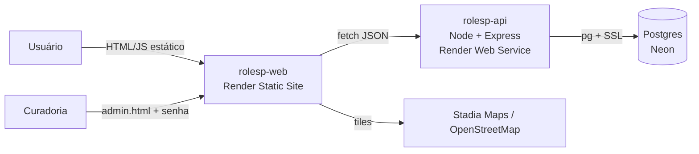

# RoleSP

> Descubra, planeje e viva São Paulo. Um mapa de rolês com preço, horário e metrô em cada card, feito para quem quer sair e não sabe para onde ir.

**Site no ar:** [rolesp-web.onrender.com](https://rolesp-web.onrender.com)


> A princípio site roda no plano gratuito do Render. Se ninguém acessou nos últimos 15 minutos, a primeira visita leva cerca de 1 minuto para "acordar" o servidor. O próprio site avisa quando isso acontece.

---

## Sumário

- [O problema](#o-problema)
- [A proposta](#a-proposta)
- [O que já funciona](#o-que-já-funciona)
- [Arquitetura](#arquitetura)
- [Curadoria de conteúdo](#curadoria-de-conteúdo)
- [Etapas de desenvolvimento](#etapas-de-desenvolvimento)
- [Decisões de projeto](#decisões-de-projeto)
- [Como o projeto foi construído com IA](#como-o-projeto-foi-construído-com-ia)
- [Validação com usuários](#validação-com-usuários)
- [Roadmap](#roadmap)
- [Limitações conhecidas](#limitações-conhecidas)
- [Rodando localmente](#rodando-localmente)
- [Contexto e equipe](#contexto-e-equipe)

---

## O problema

Quem quer sair em São Paulo enfrenta três dores, levantadas na fase de pesquisa do projeto:

1. **Descobrir tarde demais.** O evento legal aparece no feed depois que já passou.
2. **Informação fragmentada.** Cada rolê está num lugar: TikTok, Instagram, Google Maps, sites de ingresso. Montar um plano cansa.
3. **Falha logística.** Preço escondido, horário desatualizado, ninguém sabe qual metrô desce perto.

**Persona:** Fernando, 23 anos, universitário, orçamento apertado, anda de transporte público e decide o que fazer em cima da hora.

## A proposta

O RoleSP quer ser **o lugar onde se procura o que fazer em SP**, com três propósitos:

- **achar rolê quando não se sabe o que fazer**;
- **compartilhar rolês entre amigos**;
- **criar e indicar rolês** (próxima etapa).

O RoleSP não tenta ser a lista completa de eventos da cidade (Sympla, Fever e agendas culturais já ocupam esse espaço). O diferencial está em **ajudar a decidir**: informação conferida, preço e logística sempre visíveis, rolês fora do óbvio e, nas próximas etapas, busca pelo que a pessoa realmente quer e montagem de itinerário.

### As 4 regras de ouro do produto

| Regra | Na prática |
|---|---|
| **Transparência radical** | Todo card mostra preço (ou "Gratuito"), quando acontece e estação de metrô ou bairro. |
| **Zero atrito para indecisos** | Filtros de um toque, sem cadastro e sem chatbot prolixo. |
| **Dualidade de busca** | Explorar pelo mapa ou buscar algo específico. |
| **Dualidade temporal** | Rolês recorrentes (hábito, cor teal) e eventos únicos (urgência, cor coral). |

---

## O que já funciona

### Site público ([`rolesp-web/index.html`](https://rolesp-web.onrender.com))

- **Mapa interativo** (Leaflet + tiles Stamen Toner Lite via Stadia Maps) com os rolês publicados.
- **Pinos com significado:** o ícone mostra a categoria (12 ícones desenhados à mão em SVG) e a cor/forma mostra a recorrência (círculo teal = toda semana; quadrado coral = só uma vez).
- **Filtros combináveis**, aplicados no servidor:
  - atalhos **Hoje**, **Grátis** e **Até R$ 30**;
  - **12 categorias** (qualquer uma das escolhidas);
  - **tags** carregadas do banco (todas as escolhidas).
- **Gaveta de rolês** arrastável com 3 posições no celular (recolhida, meio, aberta), que vira painel lateral no computador.
- **Cards em formato de ingresso**, com canhoto de preço e selo "TODA SEMANA" ou "SÓ [DIA]".
- **Página de detalhe** com preço, horários, metrô, bairro, endereço, descrição, tags e data da última verificação, mais três ações:
  - **Mandar no WhatsApp** (link `wa.me` com resumo e link direto para o rolê);
  - **Mais informações** (link da fonte: site do lugar, Instagram do organizador ou página do evento);
  - **Como chegar** (rota no Google Maps por URL, sem API paga).
- **Link compartilhável por rolê** (`#e-ID` reabre o detalhe).
- **Aviso de "acordando o servidor"**, com até 5 tentativas e botão de tentar de novo.

### Painel de curadoria ([`rolesp-web/admin.html`](https://rolesp-web.onrender.com/admin.html))

Área restrita por senha, sem link público e com `noindex`. A senha fica só em memória, nunca no navegador nem no código.

- **Rolês:** listar por status (rascunho, publicado, arquivado), criar, editar, publicar, arquivar e excluir em lote com confirmação.
- **Lugares:** criar e editar com **clique no mapa para marcar latitude e longitude** (dispensa API de geocodificação), ativar, desativar e excluir.
- **Importação de CSV:** botão **Simular** (roda tudo e desfaz) e **Importar**, com opção de publicar direto. Tudo ou nada: se uma linha tiver erro, nada é gravado e o painel lista os erros por linha.
- **Zerar a base:** apaga tudo após digitar a frase de confirmação. Usado para recomeçar a curadoria com fontes melhores.

### API REST (este repositório)

| Rota | O que faz |
|---|---|
| `GET /api/health` | Confirma que API e banco respondem (e acorda o Neon). |
| `GET /api/meta` | Categorias, bairros e tags existentes, para montar filtros. |
| `GET /api/roles` | Lista com filtros: `categoria`, `tag`, `preco_max`, `gratuito`, `bairro`, `dia` (`hoje`, `amanha`, `dom`…`sab`), `periodo` (`madrugada`, `manha`, `tarde`, `noite`), `q`, `limit`. |
| `GET /api/roles/:id` | Um rolê. |
| `/api/admin/*` | Curadoria (`Authorization: Bearer <senha>`): CRUD de lugares e rolês, mudança de status, exclusão em lote, importação de CSV e zerar base. |

Só aparecem rolês `publicado` em lugares ativos, e eventos únicos que já passaram somem sozinhos. Dia e período levam em conta o **fuso de São Paulo** e agendas que **viram a meia-noite** (ex.: samba das 22h às 4h).

---

## Arquitetura



| Camada | Tecnologia | Por quê |
|---|---|---|
| Front | HTML, CSS e JS puros em arquivo único, Leaflet 1.9.4 | Sem build, fácil de publicar e de evoluir a partir do protótipo. |
| API | Node 20, Express, `pg`, `helmet`, `cors`, `express-rate-limit` | Simples, gratuito no Render, poucas dependências. |
| Banco | PostgreSQL no Neon | Plano gratuito sem prazo e sem cartão (o Postgres gratuito do Render expira em 30 dias). |
| Mapa | Leaflet + tiles com plano gratuito | Evita Google Maps, que exige cartão e restringe o uso dos dados. |
| Hospedagem | Render (static site + web service) | Deploy direto do GitHub, sem custo. |

**Custo mensal de infraestrutura: R$ 0.** Isso foi um requisito do projeto desde o primeiro dia.

### Modelo de dados

A separação central é **lugar** e **rolê**:

- **Lugar** é o ponto físico (nome, endereço, bairro, metrô, lat/lng). Existe uma vez e é reaproveitado.
- **Rolê** é o que acontece lá (título, categoria, preço, agenda). Um lugar pode ter vários rolês. Um restaurante só entra no mapa quando há algo específico a oferecer.

```
lugares(id, nome, endereco, bairro, lat, lng, metro, tags[], fonte_url, ativo, criado_em)
  único por (nome, bairro); lat/lng validados dentro da Grande SP

roles(id, lugar_id, titulo, descricao, categoria, tags[], preco_centavos,
      tipo,            -- 'recorrente' | 'unico'
      agenda jsonb,    -- [{"dow":2,"inicio":"20:00","fim":"23:00"}]  (0 = domingo)
      inicio, fim,     -- eventos únicos
      status,          -- 'rascunho' | 'publicado' | 'arquivado'
      fonte_url, verificado_em, criado_por, criado_em, atualizado_em)
  único por (lugar_id, titulo)
```

Preço em centavos (0 = gratuito), categoria como texto com `CHECK` e `atualizado_em` mantido por gatilho.

### Taxonomia: 12 categorias

| | | | |
|---|---|---|---|
| **Rango** (comida) | **Copo** (bar, balada) | **Palco** (shows, samba, sarau) | **Nerdices** (jogos, TCG, anime) |
| **Suor** (esporte, corrida, skate) | **Arte** (museu, galeria, grafite) | **Tela** (cinema, teatro) | **Céu aberto** (parques, mirantes) |
| **Feira** (feiras, brechós) | **Mão na massa** (oficinas, aulas) | **Comunidade** (clubes, trocas) | **Fora do óbvio** (o inusitado) |

Cada rolê tem uma categoria (que define o ícone) e várias tags (preço, com quem, período, ambiente).

### Segurança

- Segredos (`DATABASE_URL`, `ADMIN_PASSWORD`) só em variáveis de ambiente do servidor, nunca no front.
- Senha comparada em tempo constante (`crypto.timingSafeEqual` sobre hashes SHA-256).
- **10 senhas erradas por IP bloqueiam por 15 minutos**; erros de validação não contam.
- Limite geral de 600 requisições a cada 15 minutos por IP e corpo de até 20 KB (300 KB só na importação, e só depois da senha).
- Sem `ADMIN_PASSWORD` de pelo menos 12 caracteres, as rotas de curadoria ficam desligadas (503).
- Toda entrada é validada e limitada no servidor (`lib/validar.js`). O texto do usuário é tratado como dado.
- Links exibidos no site só aceitam `http(s)`, e todo texto vindo da API é escapado antes de entrar no HTML.
- CORS liberado só para os endereços em `ALLOWED_ORIGIN`. Erros internos ficam no log, nunca na resposta.
- Exclusões destrutivas exigem confirmação explícita, e lugar com rolês não pode ser apagado (`ON DELETE RESTRICT`).

---

## Curadoria de conteúdo

O valor do RoleSP depende de a informação estar certa. Por isso a curadoria segue regras rígidas:

- **Nada é inventado.** Endereço, agenda e preço só entram se uma fonte sustentar, de preferência datada e oficial.
- **Validados e parciais em arquivos separados.** O que está completo vai para o CSV de importação; o que tem pendência (falta preço, fontes divergem, horário incerto) vai para um **CSV-guia** com o que falta conferir.
- **Coordenadas conferidas no OpenStreetMap**, com tolerância de até 500 m. Acima disso, o ponto é corrigido.
- **Todo rolê tem link de "Mais informações"** para a pessoa chegar à fonte (site do lugar, Instagram, página do evento), e a data de verificação aparece no site.
- **Fontes do Instagram** ficam marcadas para conferência manual.
- Antes de importar, todo CSV passa pelo mesmo validador da API (`prepararImportacao`) e pela **simulação** no painel.

### Rodadas até agora

| Rodada | Foco | Resultado |
|---|---|---|
| 1 a 3 | Bairros centrais (Sé, República, Bela Vista, Liberdade, Paulista…) | Feiras, museus com dia gratuito, rodas de samba; pendências documentadas. |
| Revisão de CSVs de terceiros | 100 linhas coletadas por pesquisa assistida | 73 aproveitadas após limpeza; 27 removidas com motivo (duplicadas, mensais ou sem fonte). |
| 4 | Expansão para as zonas Norte, Leste, Sul e Oeste | 27 validados, 12 parciais. |
| 5 | Atividades (tours, corridas em grupo, dança, choro, stand-up) | 13 validados, 15 parciais. |

Em novembro de 2026 começou uma **revalidação completa da base**: conferir se cada link funciona e de fato informa o rolê, e se localização, dia e preço continuam corretos.

---

## Etapas de desenvolvimento

O MVP foi construído em fases curtas, cada uma com um **critério de pronto** verificável no ar.

| Fase | Data | Entrega | Pronto quando |
|---|---|---|---|
| **Concepção** | até out/2026 | Pesquisa de dores, persona, PRD, guia visual e 7 telas no Figma; protótipo funcional em HTML único. | Protótipo navegável aprovado pela equipe. |
| **0. Alinhamento** | 29–30/10 | Escopo do v0, stack de custo zero, taxonomia, identidade visual e recorte inicial (bairros centrais). | Decisões registradas. |
| **1. Banco** | 31/10 | Schema `lugares` + `roles`, seed fictício, importador de CSV por linha de comando. | SQL roda do zero no Neon e o CSV importa. |
| **2. API** | 31/10 | Express com filtros, rotas de curadoria protegidas, deploy no Render. | API responde no Render e filtra por categoria, tag, preço e dia. |
| **3. Mapa** | 01/11 | Front com Leaflet, pinos por categoria e recorrência, filtros, gaveta, detalhe e WhatsApp. | O mapa mostra os rolês do banco no site publicado. |
| **4. Painel** | 02/11 | `admin.html`, clique no mapa para coordenadas, importação de CSV pela API (simular, tudo ou nada, reimportar sem duplicar). | Criar e publicar um rolê sem tocar em código e vê-lo no mapa. |
| **5. Conteúdo e publicação** | nov/2026 (em andamento) | Curadoria real em rodadas, tiles de produção, link "Mais informações", exclusão em lote, zerar base, entrevistas de validação, expansão para outras zonas. | Cinco pessoas de fora acham algo que fariam, sem ajuda. |

---

## Decisões de projeto

| Decisão | Motivo |
|---|---|
| **MVP v0 enxuto:** só mapa, banco e painel de curadoria. | Validar se as pessoas acham rolês úteis antes de investir em IA, login ou roteiros. |
| **Curadoria própria antes de abrir para usuários.** | Sem uma base boa, ninguém volta e ninguém contribui. Envio por usuários vem depois, com fila de aprovação. |
| **Recorrentes como base, únicos como tempero.** | Rolês semanais são estáveis e baratos de manter; eventos únicos exigem verificação constante. |
| **Lugar e rolê como entidades separadas.** | Um lugar tem vários rolês; desativar um lugar tira todos do mapa de uma vez. |
| **Leaflet em vez de Google Maps.** | Google exige cartão e proíbe usar seus dados de lugares fora do mapa dele. |
| **Neon em vez do Postgres do Render.** | O Postgres gratuito do Render expira em 30 dias. |
| **Front em arquivo único, sem build.** | Menos peças para quebrar, deploy instantâneo e evolução direta do protótipo. |
| **Filtros no servidor.** | O front fica simples e a mesma lógica servirá à busca por IA. |
| **Ícone = categoria; cor = recorrência.** | Duas informações num pino só, sem poluir o mapa com preços. |
| **Importação "tudo ou nada" com simulação.** | Erro de curadoria nunca entra pela metade; dá para testar sem medo. |
| **Reimportar atualiza conteúdo, mas não muda status.** | Corrigir um CSV não republica algo que a curadoria arquivou. |
| **Senha única da curadoria em variável de ambiente.** | Suficiente para uma equipe pequena; login de verdade só quando houver usuários. |
| **"Mais informações" obrigatório na curadoria.** | O RoleSP é a ponte entre a pessoa e o rolê, não o destino final. A fonte precisa estar a um toque. |
| **WhatsApp só por link (`wa.me`).** | A API oficial cobra por mensagem e exige conta comercial. Link resolve o compartilhamento de graça. |
| **Começar pelo centro e depois expandir.** | O recorte central permitiu validar o fluxo com pouca curadoria; a expansão para as outras zonas aumenta a variedade e serve quem não mora no centro. |
| **Visual "adesivo", só tema claro.** | Bordas escuras, sombras duras e cards de ingresso dão personalidade reconhecível e compartilhável. |

---

## Como o projeto foi construído com IA

O RoleSP foi desenvolvido com o **Claude (Anthropic) como co-desenvolvedor**, dentro de um processo pensado para manter contexto, qualidade e controle humano ao longo de várias conversas.

### Método

- **Base de conhecimento do projeto.** Um `SKILL.md` define o papel da IA e as regras inegociáveis: nunca inventar rolês reais, segredos nunca no front, custo zero, pesquisar limites de serviços antes de afirmar, uma decisão por vez. Documentos de referência (`produto.md`, `arquitetura.md`, `plano.md`) são lidos antes de qualquer resposta.
- **Uma conversa por fase.** Cada fase termina com um documento de passagem (`fase-3.md`, `fase-4.md`…) que descreve o estado atual, as lições aprendidas e as decisões a tomar, para a próxima conversa começar sem perder contexto.
- **Registro de decisões.** Toda conversa termina com o que foi decidido, o que foi entregue e o que está pendente, consolidado no plano do projeto.
- **Critério de pronto verificado por humano.** A IA testava localmente (Postgres 16, servidor Express); o deploy e os testes no ar eram feitos por mim e relatados na conversa, sem compartilhar segredos.

### Divisão de papéis

| Eu (humano) | IA |
|---|---|
| Visão de produto, prioridades e decisões finais | Propostas com recomendação e trade-offs |
| Contas, deploy, variáveis de ambiente e testes em produção | Código, SQL, validação e testes locais |
| Entrevistas com usuários e validação final da curadoria | Pesquisa de fontes, limpeza de CSVs e checagem de coordenadas |

### IA na curadoria

A coleta de rolês usa pesquisa assistida por IA, mas com uma esteira de validação: cada linha precisa de fonte, passa pelo mesmo validador da API, tem coordenadas conferidas contra o OpenStreetMap, e o que não fecha vai para o CSV-guia em vez de entrar no site.

### IA no produto (próxima etapa)

A busca em linguagem natural ("sábado, uns R$ 40, comer barato, algo diferente no centro") já tem arquitetura definida:

- `POST /api/interpretar` transforma o texto em **filtros estruturados** usando saída estruturada de um modelo de linguagem;
- um **leitor de regras** serve de reserva quando a IA falhar ou estiver indisponível;
- a IA **só escolhe entre IDs que existem no banco**, e o servidor valida isso antes de responder: nome, preço e horário sempre vêm do banco;
- a interface **mostra os filtros usados**, para a pessoa entender e ajustar;
- buscas sem resultado são registradas (sem dados pessoais) para orientar a curadoria;
- meta de qualidade: **70% de respostas úteis** num conjunto de teste montado com frases reais coletadas em entrevistas.

---

## Validação com usuários

Antes de divulgar o link, foram feitas entrevistas com pessoas de fora do projeto. Pontos que viraram backlog:

- mostrar menos rolês no zoom afastado e mais conforme a pessoa aproxima;
- destacar rolês em alta e clássicos de SP;
- filtros de dia e horário visíveis na tela;
- distribuir melhor os rolês entre as categorias.

O critério de pronto do MVP continua sendo: **cinco pessoas de fora usam o site e encontram algo que fariam, sem ajuda.**

---

## Roadmap

**Próximos passos (nov/2026)**
- Corrigir os pontos das entrevistas.
- Ampliar bastante a curadoria e concluir a revalidação da base.
- Login e aba de favoritos.
- Busca em linguagem natural ligada ao banco.
- **"Indique um rolê"** (recorrente ou pontual), com aprovação da equipe e crédito para quem indicou.

**Depois**
- "Tô sem ideia": três perguntas de um toque (com quem, quanto, quando) e três sugestões.
- Itinerário com vários rolês, horários, custo total e link compartilhável.
- "Bora?": enquete por link para decidir com o grupo.
- Agenda com salvos e "Adicionar ao Google Agenda".
- Atalho "Tá chovendo" com rolês cobertos.

---

## Limitações conhecidas

- **Primeira visita lenta:** o plano gratuito do Render dorme após 15 minutos sem acesso.
- **Sem testes automatizados ainda;** os testes foram manuais, localmente e em produção.
- Vários rolês no mesmo lugar geram **pinos sobrepostos**.
- A importação por CSV aceita só rolês recorrentes por dia da semana; padrões como "último sábado do mês" ainda não cabem.
- Parte das coordenadas da curadoria mais recente é aproximada e está sendo ajustada no painel.
- O painel usa uma senha única compartilhada pela equipe.

---

## Rodando localmente

**Pré-requisitos:** Node.js 20+ e um banco Postgres (o Neon gratuito serve).

```bash
git clone <este-repositório>
cd RoleSP
npm install
cp .env.example .env   # preencha as variáveis abaixo
npm run dev
```

Abra `http://localhost:3000/api/health` (deve responder `{"ok":true}`) e `http://localhost:3000/api/roles`.

| Variável | Descrição |
|---|---|
| `DATABASE_URL` | Connection string do Postgres (no Neon, a versão *pooled* com `?sslmode=require`). |
| `ADMIN_PASSWORD` | Senha da curadoria, com 12 ou mais caracteres. Sem ela, as rotas de admin ficam desligadas. |
| `ALLOWED_ORIGIN` | Endereços do site autorizados, separados por vírgula, sem barra no final. |
| `PORT` | Opcional; o Render define sozinho. |
| `PGSSL=off` | Só para Postgres local sem SSL. |

**Front:** o site fica no repositório `rolesp-web`. Para testar localmente, sirva a pasta com `npx serve`, aponte a constante `API` no início do `index.html` para `http://localhost:3000` e inclua o endereço local em `ALLOWED_ORIGIN`. Abrir o arquivo com duplo clique não funciona por causa do CORS.

**Deploy:** no Render, crie um *Web Service* a partir do repositório (build `npm install`, start `npm start`, plano Free) ou use o `render.yaml` como Blueprint, e cadastre as variáveis em *Environment*. Ao publicar mudanças que dependem uma da outra, publique primeiro a API e depois o site.

### Estrutura

```
RoleSP/                  (API)
├── server.js            rotas públicas, de curadoria e tratamento de erros
├── lib/
│   ├── validar.js       validação de lugares, rolês, agendas e links
│   ├── quando.js        texto legível de horários ("Seg a Qua, 11h–15h")
│   └── importar.js      leitura de CSV, validação e gravação em transação
├── render.yaml          Blueprint do Render
└── package.json

rolesp-web/              (site estático)
├── index.html           mapa público
└── admin.html           painel de curadoria
```

---

## Contexto e equipe

Projeto da disciplina **ACH2008: Empreendedorismo em Informática** (EACH-USP), com a Profa. Luciane Meneguin Ortega.

**Concepção do produto (pesquisa, PRD e protótipo):** Bruno Kraker, Pedro Henryk B. Souza, Rodrigo Franco de Moraes, Rômulo M. Fonseca Júnior e Thales Iamamura.

**Desenvolvimento do MVP:** Rodrigo Franco de Moraes, com o Claude como co-desenvolvedor.

Dados de mapa © [OpenStreetMap](https://www.openstreetmap.org/copyright) contributors (ODbL). Tiles © Stadia Maps, © Stamen Design, © OpenMapTiles.
